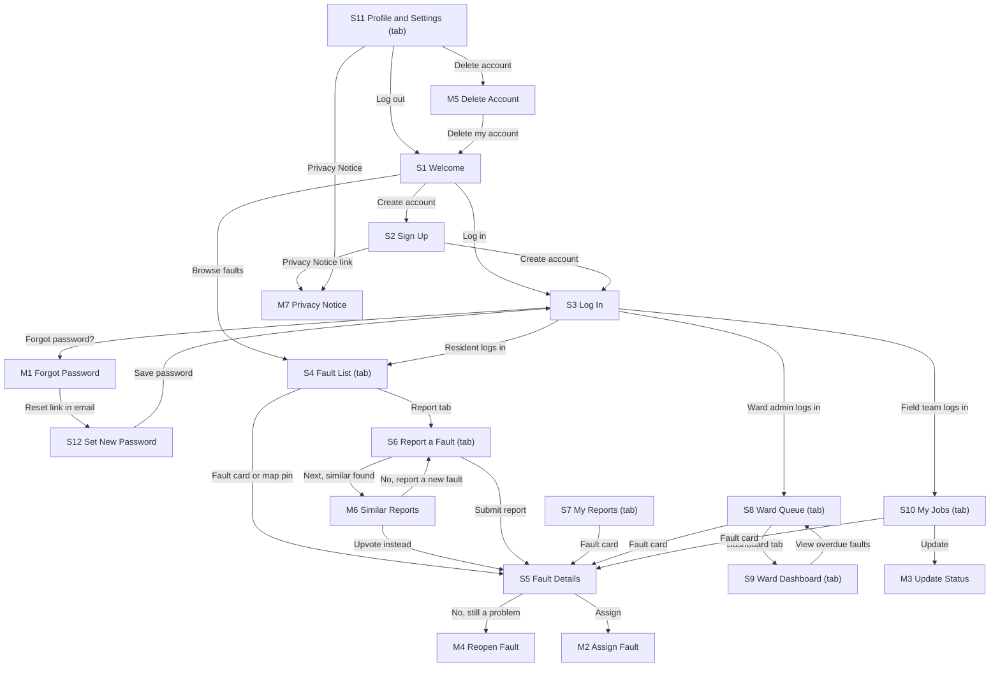

# FixMyKasi: Product Requirements Document

## Document details

| Field | Our answer |
| --- | --- |
| Product name | FixMyKasi |
| Author(s) | Team Grok: Sijabulile Ncube (Product Owner), Bheki Buthelezi, Bafana Ndlovu, Bao Kekana, Mhlengi Ngwenya. No student numbers have been issued. |
| Course code and cohort | AI Augmented Software Development, 2026 April cohort (SNPL) |
| Facilitator / reviewer | Mnelisi Maswanganyi |
| Link to our original app idea | Team brief "FixMyKasi: What Our App Does" (9 Nov 2026), shared with the team on WhatsApp |
| GitHub repository | https://github.com/Paul280-cloud/fixmykasi (this file is `docs/PRD.md`) |
| Version | v0.2 |
| Status | Draft |

### Change log

| Version | Date | Section(s) changed | What changed | Regenerated? (screens / MASTER.md / none) |
| --- | --- | --- | --- | --- |
| v0.1 | 10 Nov 2026 | All | First draft, written from the team brief of 9 Nov 2026. Should features cut from 4 to 3 to fit the template: the ward councillor view moved to Future features (4.3). | None |
| v0.2 | 10 Nov 2026 | 9.1, 8.3 | Colour scheme changed to the national Coat of Arms colours used on South African government websites (green, brown, gold, orange and white). Header is now Heritage Brown with a gold line. | None |

---

## 1. Product overview

**1.1 Product name:** FixMyKasi

**1.2 One-line pitch:** FixMyKasi helps South African residents to report community faults so that they see who fixes them, and when.

**1.3 Problem statement**

Residents see potholes, burst water and sewer pipes, blocked manholes and broken streetlights every day, but many do not know which municipal department or number to report them to. Reports are made by phone, WhatsApp groups or through the ward councillor, so the same fault is often reported many times and nobody can see what happened to it. A study of a national reporting app found that complaints took an average of 101 days to resolve. Residents are left guessing whether anyone is working on the fault, who is responsible and when it will be fixed.

**1.4 Solution**

A resident logs in, takes a photo of the fault, adds the location and a short description, and gets a reference number straight away. Before submitting, they see similar reports nearby and can upvote one instead of reporting it again. The ward admin assigns each fault to a municipal team or a named contractor with a due date. Everyone can follow the fault through each status until the resident confirms it is fixed, or reopens it if it is not.

**1.5 Platform:** Web app (works in a browser). We design and build mobile-first at 390 px wide, because most residents will use a phone. The ward admin screens (S8 Ward Queue and S9 Ward Dashboard) are also designed for desktop at 1440 px wide.

**1.6 Vision:** In two years, every ward in a metro can use FixMyKasi to publish its open faults and repair times, so that residents and councillors can hold departments and contractors to their promised dates.

**1.7 Key terms**

| Term | Exact meaning in this app |
| --- | --- |
| Fault | One problem on public property that a resident reports, such as a pothole. Never "issue", "complaint" or "ticket". |
| Reference number | The unique number a fault gets when it is submitted, in the format FMK-2026-00123 (BR1). |
| Ward | The area a fault is in. Each ward has one ward admin. |
| Ward admin | The municipal staff member who checks, assigns and manages the faults in one ward. |
| Field team | The group that repairs a fault. It is either a municipal team or a contractor company. |
| Contractor | A private company the municipality outsources a fault to. Its company name is always shown. |
| Upvote | A resident's way of saying "this affects me too" on an existing fault, instead of reporting it again. |
| Status | Where a fault is in its journey: Received, Viewed, Assigned, Scheduled, In progress, Fixed, Closed or Reopened (10.3). |

---

## 2. Users, personas and roles

**2.1 Primary user:** Residents aged 18 to 65 living in townships and suburbs in the City of Johannesburg. They use an Android phone, often on prepaid mobile data, with Medium tech comfort. They use WhatsApp and Facebook every day but rarely use municipal websites.

**2.2 Secondary users:**
- **Ward admins:** municipal staff who manage one ward's faults, mostly on a laptop at the office and sometimes on a phone.
- **Field team members:** municipal team leaders and contractor staff who update the faults assigned to them, on a phone while on site.

**2.3 Personas**

| Field | Persona 1 | Persona 2 | Persona 3 |
| --- | --- | --- | --- |
| Name and age | Thandeka Mokoena, 34 | Zanele Khumalo, 46 | Kagiso Molefe, 29 |
| Role (from 2.4) | Resident | Ward admin | Field team |
| Occupation / situation | Nurse living in Orlando West, Soweto | Municipal service delivery officer for one ward | Plumbing team leader at a contractor company |
| Device and connectivity | Android phone, prepaid data, often under 1 GB left | Office laptop on Wi-Fi, Android phone on contract | Android phone, mobile data on site |
| Tech comfort | Medium | Medium | Medium |
| Language(s) | isiZulu, English | English, Sepedi | Setswana, English |
| Goal | Get the burst pipe outside her house fixed, and know when | See every fault in her ward in one place and assign it quickly | Know which jobs are his, where they are, and close them off |
| Frustrations today | She phoned the call centre twice, got two reference numbers and no update | The same fault arrives from WhatsApp, phone calls and the councillor, with no photo or exact location | Jobs come by phone with unclear addresses, and nobody records that he finished them |
| How the app helps | One report with a photo, a reference number and a status she can check any time | One queue per ward, sorted by urgency and upvotes, with photos and locations | A job list with photos and landmarks, and a simple way to mark work done with an after photo |
| Quote | "I just want to know someone is coming." | "If I can see it, I can assign it." | "Give me the right address and I'll fix it the same day." |

**2.4 Roles and permissions**

Every "Cannot do" is blocked by Row-Level Security (RLS) in the database (11.4), not only hidden on the screen.

| Role | How someone gets this role | Can do | Cannot do |
| --- | --- | --- | --- |
| Visitor (logged out) | Anyone who opens the app | View the fault list (S4) and fault details (S5) | Report, upvote, confirm or reopen a fault. See any reporter's name or contact details. |
| Resident | Anyone 18 or older who signs up on S2 | Everything a visitor can do, plus report faults, upvote other residents' faults, see their own reports on S7, confirm or reopen their own fixed faults, edit their profile and delete their account | Upvote their own fault. Edit or delete a fault after submitting it. See other residents' names or contact details. Assign or update the status of any fault. |
| Ward admin | Created by the admin in the Supabase dashboard and linked to one ward | View every fault in their ward with photos, assign faults to a field team, set due dates and estimated time, record the municipality's reference number, mark faults Viewed, and see the ward dashboard | Manage faults in any other ward. Upvote, confirm or reopen faults. Change a resident's description or photos. |
| Field team | Created by the admin in the Supabase dashboard and linked to one field team | View the faults assigned to their field team, change their status to Scheduled, In progress or Fixed, mark them delayed, and upload after photos | See or change faults not assigned to their field team. Assign faults. Confirm or reopen faults. |

**2.5 Admin:** Admin work is done directly in the Supabase dashboard, with no admin screens in v1. This covers creating ward admin and field team accounts, and maintaining wards, fault types and field teams.

---

## 3. Goals, success metrics and non-goals

**3.1 Goals**

| # | Goal | Metric (what we count) | Target | How we will check it |
| --- | --- | --- | --- | --- |
| G1 | Reporting a fault is quick | Time from opening S6 Report a Fault to seeing the reference number | 8 of 10 testers in under 3 minutes | User test with 10 classmates on their own phones, timed |
| G2 | Every assigned fault has a named owner and a date | Faults with status Assigned or later that have a field team and a due date | 100% | SQL count on the `faults` table during testing |
| G3 | Residents can follow up without phoning anyone | Testers who find the status, field team and due date of a given reference number | 9 of 10 testers in under 30 seconds | User test with 10 classmates |
| G4 | Fewer duplicate reports | Times a tester chooses "Upvote instead" on M6 when a similar report exists | 7 of 10 testers in the duplicate test | User test with a seeded duplicate fault |

**3.2 Non-goals**
- **No link to real municipal systems:** we have no agreement with a municipality, so test accounts play the ward admins and field teams.
- **No native Android or iPhone app:** a mobile-first web app reaches residents without an app store download.
- **No SMS, WhatsApp or push messages:** each SMS costs money, and the status on S5 and S7 is enough for v1.
- **No faults on private property:** the app only covers public infrastructure, such as roads and streetlights.
- **No chat between residents and field teams:** this protects field team members' privacy and keeps the scope small.
- **No ward councillor accounts:** moved to Future features (4.3) to keep the MVP to 3 Should features.

---

## 4. Features, business rules and notifications

**4.1 Feature list**

| ID | Feature name | What the user can do (every action) | Priority | Goal (G#) | Stories (US#) | Screens (S#) |
| --- | --- | --- | --- | --- | --- | --- |
| F1 | Account and report a fault | Sign up, verify email, log in, reset password, log out, delete account, choose a language, report a fault with photos, fault type, location and description, and get a reference number | Must | G1 | US1, US2, US3, US4 | S1, S2, S3, S6, S11, S12, M1, M5, M7 |
| F2 | Public fault list and upvotes | Browse, filter and search faults, open a fault's details, see similar reports before submitting, and upvote or remove an upvote | Must | G3, G4 | US5, US6 | S4, S5, M6 |
| F3 | Assign the work | Ward admin sees the ward queue, opens a fault (marking it Viewed), and assigns it to a field team with a due date and estimated time to fix | Must | G2 | US7 | S8, S5, M2 |
| F4 | Track progress | Field team schedules, starts, delays and fixes a fault. Residents see every status change with dates, and confirm the fix or reopen the fault. | Must | G3 | US8, US9, US10 | S5, S7, S10, M3, M4 |
| F5 | Ward dashboard | Ward admin sees open faults, overdue faults, average time to fix and open faults by category | Must | G2 | US11 | S9 |
| F6 | Proof of work | Field team uploads 1 to 3 after photos when marking a fault Fixed, and everyone sees before and after photos | Should | G3 | US12 | M3, S5 |
| F7 | AI help | AI suggests the fault type and urgency from the photo and description, and translates descriptions into English for staff | Should | G1 | US13 | S6, S5 |
| F8 | Map view | See faults as pins on a map, coloured and labelled by status | Should | G4 | US14 | S4 |

**4.2 MVP definition:** A resident can report a fault with a photo and location, a ward admin can assign it to a named field team with a due date, and the resident can see its status until they confirm it is fixed.

**4.3 Future features**
- Ward councillor view: a read-only ward dashboard with an alert when a fault becomes overdue
- Reporting by WhatsApp
- The other 7 official languages: isiXhosa, Setswana, Sesotho, Xitsonga, siSwati, Tshivenda and isiNdebele
- Voice note reports and a low-data mode
- Monthly PDF reports for ward councillors

**4.4 Business rules**

| ID | Rule (exact logic, numbers and limits) | Used by (F#, S#) |
| --- | --- | --- |
| BR1 | Every fault gets a reference number when it is saved: "FMK-", the year it was reported, "-", then a 5-digit number that starts at 00001 each year and goes up by 1 (e.g. FMK-2026-00123). It never changes and is unique. | F1, S6, S5, S7 |
| BR2 | A report needs 1 to 3 photos in JPG, PNG, HEIC or WebP, each up to 10 MB. The browser resizes each photo so its longest side is at most 1600 px, compresses it to under 500 KB and removes location data (EXIF) before upload. If the resident ticks "It is not safe to take a photo", 0 photos are allowed and the description must be at least 30 characters. | F1, S6 |
| BR3 | A report needs a ward (dropdown, defaults to the resident's home ward), a street address (5 to 120 characters) and, optionally, a landmark (up to 60 characters). The app asks the browser for GPS once per report. If allowed, it saves latitude and longitude. If refused, the report still works without them. | F1, S6 |
| BR4 | Similar reports: before submitting, the app looks for faults in the same ward with the same fault type, status not Closed, reported in the last 30 days. If both faults have GPS, only those within 200 m count. Up to 5 are shown on M6, closest first, or newest first without GPS. If none are found, M6 is skipped. | F2, M6, S6 |
| BR5 | A resident can upvote a fault once, and remove their upvote at any time. They cannot upvote their own fault or a Closed fault. The upvote count shows on S4 and S5. | F2, S4, S5 |
| BR6 | The fault list (S4) shows 20 faults at a time, newest first, and loads the next 20 when the user scrolls to the end. Filters: ward, category and status. Sort options: "Newest" (default) and "Most upvoted". The search box matches a reference number exactly, or a street address containing the typed words. | F2, S4 |
| BR7 | The ward queue (S8) shows only faults in the ward admin's ward that are not Closed. Order: urgent faults first, then by upvotes (most first), then by date reported (oldest first). Tabs: "New" (Received, Viewed, Reopened), "In progress" (Assigned, Scheduled, In progress) and "Fixed" (Fixed). | F3, S8 |
| BR8 | Assigning (M2): only the ward admin of the fault's ward can assign. The field team list only shows teams whose category matches the fault's category. The due date must be between today and 90 days from today (SAST). The estimated time to fix is a whole number of days, 1 to 90. The municipality's reference number is optional, up to 30 characters. Saving sets the status to Assigned. | F3, M2 |
| BR9 | Statuses can only change as listed in 10.3. Every change saves a StatusChange record with the old status, new status, who made the change, an optional note (up to 200 characters) and the date and time. | F3, F4, S5, S7 |
| BR10 | The first time the fault's ward admin opens a Received fault on S5, its status changes to Viewed automatically. | F3, S5 |
| BR11 | A fault is overdue when today's date (SAST) is after its due date and its status is not Fixed or Closed. Overdue is shown as a red "Overdue" label with an icon. It is worked out each time and never saved as a status. | F3, F4, F5, S4, S5, S8, S9, S10 |
| BR12 | A field team can mark an assigned fault as delayed by entering a reason (10 to 200 characters) and a new due date. The new date must be after the current due date and no more than 90 days from today. The status does not change, and the fault shows a "Delayed" label. | F4, M3 |
| BR13 | Marking a fault Fixed records the date and time it was fixed. Once F6 is built, at least 1 after photo is required to mark a fault Fixed (same file rules as BR2). | F4, F6, M3 |
| BR14 | Only the resident who reported a fault can confirm or reopen it, and only while it is Fixed. "Yes, it's fixed" changes it to Closed. "No, still a problem" needs a reason (10 to 200 characters) and changes it to Reopened, which sends it back to the ward admin's "New" tab. A fault can be reopened at most 2 times. If the resident does nothing for 7 days after it is Fixed, a daily job at 02:00 SAST changes it to Closed. | F4, S5, M4 |
| BR15 | Ward dashboard figures (S9) for the ward admin's ward: Open faults is every fault that is not Closed. Overdue faults follows BR11. Average time to fix is the average number of days between the date reported and the date fixed, for faults fixed in the last 30 days, rounded to 1 decimal place ("No data" if there are none). Open faults by category counts open faults per category. | F5, S9 |
| BR16 | Public screens (S4, S5) never show a reporter's name, email or phone number. They show the field team's name, and for a contractor, the company name. Field team members' names and phone numbers are visible only to the fault's ward admin. | F2, F3, S4, S5 |
| BR17 | A resident can submit at most 5 faults in any 24 hours. The description must be 10 to 500 characters. | F1, S6 |
| BR18 | The interface is available in English, Afrikaans, isiZulu and Sepedi. The first visit uses the browser's language if it is one of these four, otherwise English. The choice is saved in the resident's profile and can be changed on S1 and S11. Descriptions are saved exactly as typed, with the language they were written in. | F1, S1, S11 |
| BR19 | Fault types with "auto urgent" set (fallen or exposed wires, missing manhole cover, missing drain cover, major pipe burst, broken traffic light) are marked urgent automatically, and the resident cannot untick it. For other fault types, the resident can tick "This is dangerous". | F1, S6 |
| BR20 | AI help (F7): after the resident adds a photo and at least 10 characters of description, the app suggests a fault type and whether it is urgent. The suggestion is shown as a chip the resident must tap to accept. If the AI is slow (over 8 seconds) or fails, nothing is shown and the form works as normal. Descriptions not written in English are translated into English for the ward admin and field team, labelled "Translated by AI", with the original shown underneath. | F7, S6, S5 |
| BR21 | Map view (F8): pins use the fault's GPS location. Faults without GPS are not shown on the map, and a note under the map says how many are hidden. Each pin's colour matches the status chip, and tapping it shows the reference number, fault type and status, with a link to S5. | F8, S4 |

**4.5 Notifications**

FixMyKasi sends no in-app, push or SMS notifications in v1. Residents check progress on S7 My Reports and S5 Fault Details. The only messages are the two account emails sent by Supabase Auth:

| Trigger | Who receives it | Channel | Exact text | Tapping it opens |
| --- | --- | --- | --- | --- |
| A resident signs up on S2 | The new resident | Email | Subject "Confirm your FixMyKasi account". Body "Welcome to FixMyKasi! Tap the button to confirm your email address." Button "Confirm email". | S3 Log In with the message "Email confirmed. Please log in." |
| A user asks to reset their password on M1 | That user | Email | Subject "Reset your FixMyKasi password". Body "Tap the button to choose a new password. This link expires in 1 hour." Button "Reset password". | S12 Set New Password |

---

## 5. Accounts and sign-in

| Decision | Our answer |
| --- | --- |
| Sign-up methods | Email and password, through Supabase Auth |
| Who may sign up | Anyone can sign up as a Resident on S2. Ward admin and field team accounts are created by the admin in the Supabase dashboard, never through S2. |
| Minimum age | 18. S2 has a required checkbox "I am 18 or older". |
| Email verification | Required. Before verifying, a user can browse S4 and S5 but cannot report, upvote, confirm or reopen. Trying to do so shows "Please confirm your email first. Check your inbox." with a "Resend email" link. |
| Password rules | At least 8 characters, with at least 1 letter and 1 number. Every password field has a show/hide eye button. |
| Forgot password | "Forgot password?" on S3 opens M1. The user enters their email and taps "Send link". M1 always shows "If this email has an account, we've sent a reset link." The link lasts 1 hour and opens S12, where the user sets a new password. |
| Failed log-in attempts | Supabase Auth limits repeated attempts. When it refuses an attempt, S3 shows "Too many attempts. Please wait a few minutes and try again." A wrong password shows "Wrong email or password." |
| Stay logged in | The session renews itself automatically, so the user stays logged in on that browser until they log out. |
| Log out | "Log out" button on S11. No confirmation. Goes to S1 Welcome. |
| Delete account | "Delete account" on S11 opens M5. Confirming deletes the user's login, profile and upvotes immediately. Faults they reported stay public, because neighbours rely on them, but the link to the user is removed so they become anonymous. |
| Change email or phone | Email cannot be changed in v1. The user can delete their account and sign up again. The optional phone number can be edited on S11. |

---

## 6. User stories, acceptance criteria and edge cases

**6.1 Stories**

| Story | Feature | User story | Acceptance criteria (with test IDs) |
| --- | --- | --- | --- |
| US1 | F1 | As a visitor, I want to create an account so that I can report faults. | **T-US1-1:** Given I am on S2, when I enter my full name, email, a password like "kasi2026", tick both checkboxes and tap "Create account", then I go to S3 with the banner "Check your email to confirm your account." **T-US1-2 (unhappy):** Given the email already has an account, when I tap "Create account", then S2 shows "This email already has an account. Log in instead." under the email field. **T-US1-3 (unhappy):** Given my password is "kasikasi" (no number), when I tap "Create account", then the password field shows "Use at least 8 characters with a letter and a number." |
| US2 | F1 | As a resident, I want to log in and reset my password if I forget it so that I can get back to my reports. | **T-US2-1:** Given I have a confirmed account, when I log in on S3, then I go to S4 Fault List. **T-US2-2 (unhappy):** Given I type the wrong password, when I tap "Log in", then S3 shows "Wrong email or password." and keeps my email. **T-US2-3:** Given I tap "Forgot password?" and enter my email on M1, when I tap "Send link", then M1 shows "If this email has an account, we've sent a reset link." **T-US2-4 (unhappy):** Given my reset link is older than 1 hour, when I open it, then S12 shows "This link has expired. Request a new one." with a "Send new link" button that opens M1. |
| US3 | F1 | As a resident, I want to report a fault with a photo, location and description so that the right team can find and fix it. | **T-US3-1:** Given I am logged in and verified, when I complete S6 and tap "Submit report", then I see "Fault reported. Your reference number is FMK-2026-00125." and go to S5 for that fault, with status Received. **T-US3-2 (unhappy):** Given I have not added a photo or ticked "It is not safe to take a photo", when I tap "Submit report", then S6 shows "Add at least 1 photo." **T-US3-3 (unhappy):** Given I have already reported 5 faults in the last 24 hours, when I tap "Submit report", then S6 shows "You can report up to 5 faults a day. Please try again tomorrow." and keeps my form. **T-US3-4 (unhappy):** Given my upload fails, when I tap "Submit report", then S6 shows "Upload failed. Check your connection." with "Try again", and keeps my photos and text. |
| US4 | F1 | As a resident, I want to use the app in my own language and delete my account if I want to so that I stay in control. | **T-US4-1:** Given I am on S11, when I change Language to "isiZulu", then every label on every screen changes to isiZulu, and the choice is kept after I log out and in again. **T-US4-2:** Given I tap "Delete account" on S11 and confirm on M5, when the deletion finishes, then I go to S1 with the message "Your account has been deleted." and my faults show no link to me. **T-US4-3 (unhappy):** Given the deletion fails, when I confirm on M5, then M5 shows "Something went wrong. Try again." and my account stays. |
| US5 | F2 | As a resident, I want to browse and search faults so that I can check whether a fault is already reported and see its progress. | **T-US5-1:** Given there are faults, when I open S4, then I see up to 20 fault cards, newest first. **T-US5-2:** Given I type "FMK-2026-00123" in search, when I tap search, then only that fault is shown. **T-US5-3 (unhappy):** Given my filters match nothing, when the list loads, then S4 shows "No faults match your filters." with a "Clear filters" button. |
| US6 | F2 | As a resident, I want to see similar reports and upvote one so that I don't report the same fault twice. | **T-US6-1:** Given a Scheduled burst pipe exists 80 m away in my ward, when I tap "Next" on S6, then M6 shows it with the title "Is this the same fault?" **T-US6-2:** Given M6 is open, when I tap "Upvote instead", then the upvote is saved, I go to S5 for that fault, and I see the toast "Thanks, your upvote was added." **T-US6-3 (unhappy):** Given I reported the fault myself, when I view it on S5, then the upvote button is disabled with the text "You reported this fault". |
| US7 | F3 | As a ward admin, I want to assign a fault to a field team with a due date so that someone owns the repair. | **T-US7-1:** Given a Received fault in my ward, when I open it on S5, then its status becomes Viewed. **T-US7-2:** Given I fill in M2 and tap "Assign", then the status becomes Assigned and S5 shows the field team name, due date and estimated time. **T-US7-3 (unhappy):** Given I pick a due date 120 days away, when I tap "Assign", then M2 shows "Choose a date within the next 90 days." **T-US7-4 (unhappy):** Given I am a ward admin for another ward, when I try to assign this fault, then the database refuses it and I see "You can only manage faults in your ward." |
| US8 | F4 | As a field team member, I want to update the status of my jobs so that residents know what is happening. | **T-US8-1:** Given an Assigned fault on S10, when I choose "Scheduled" on M3 and save, then the status changes and the history on S5 shows the date and time. **T-US8-2:** Given an In progress fault, when I mark it delayed with a reason and a new date, then S5 shows "Delayed" and the new due date. **T-US8-3 (unhappy):** Given a fault is not assigned to my field team, when I try to change its status, then the database refuses it and I see "You can only update faults assigned to your team." |
| US9 | F4 | As a resident, I want to see every status change of my fault so that I know who is fixing it and by when. | **T-US9-1:** Given my fault is Scheduled, when I open it on S5, then I see the status timeline with dates, the field team name, "Contractor: Sample Plumbing Services (Pty) Ltd", the due date and the estimated time. **T-US9-2:** Given its due date has passed and it is not Fixed, when I open S5 or S7, then I see a red "Overdue" label. **T-US9-3 (unhappy):** Given I have reported no faults, when I open S7, then I see "You haven't reported any faults yet." with a "Report a fault" button. |
| US10 | F4 | As a resident, I want to confirm the fix or reopen the fault so that it is only closed when the problem is really solved. | **T-US10-1:** Given my fault is Fixed, when I tap "Yes, it's fixed" on S5, then it becomes Closed and I see the toast "Thanks for confirming." **T-US10-2:** Given my fault is Fixed, when I tap "No, still a problem" and enter a reason on M4, then it becomes Reopened. **T-US10-3 (unhappy):** Given my fault has already been reopened 2 times, when it is Fixed again, then the reopen button is replaced with "This fault can't be reopened again. Please report a new fault." **T-US10-4:** Given my fault has been Fixed for 7 days with no response, when the daily job runs, then it becomes Closed. |
| US11 | F5 | As a ward admin, I want a dashboard of my ward so that I can see what is open, overdue and how fast we fix faults. | **T-US11-1:** Given my ward has the sample data, when I open S9, then I see Open faults 4, Overdue faults 1 and Average time to fix 5.0 days, matching BR15. **T-US11-2 (unhappy):** Given no faults were fixed in the last 30 days, when I open S9, then Average time to fix shows "No data" with "No faults fixed in the last 30 days." |
| US12 | F6 | As a field team member, I want to upload after photos when I fix a fault so that the resident can see the work was done. | **T-US12-1:** Given I choose "Fixed" on M3, when I add 1 after photo and save, then S5 shows "Before" and "After" photos side by side. **T-US12-2 (unhappy):** Given I choose "Fixed" with no photo, when I tap "Save", then M3 shows "Add at least 1 after photo." |
| US13 | F7 | As a resident, I want the app to suggest the fault type so that I can report faster. | **T-US13-1:** Given I add a photo of a pothole and type "big hole in the road", when the suggestion appears, then I see the chip "Suggested: Pothole" and tapping it fills in Fault type. **T-US13-2 (unhappy):** Given the AI fails or takes over 8 seconds, when I fill in S6, then no chip is shown and I can still pick the fault type myself. **T-US13-3:** Given a description written in isiZulu, when the ward admin opens S5, then they see the English translation labelled "Translated by AI" with the original underneath. |
| US14 | F8 | As a resident, I want to see faults on a map so that I can find faults near me. | **T-US14-1:** Given faults with GPS, when I tap "Map" on S4, then I see a pin for each one, and tapping a pin shows its reference number, fault type and status with a "View fault" link to S5. **T-US14-2 (unhappy):** Given 2 faults have no GPS, when the map loads, then a note under it says "2 faults without a map location are not shown." |

**6.2 Edge cases**

| Situation | What the user sees (exact text) | What the app does |
| --- | --- | --- |
| The resident loses internet while filling in S6 | "You're offline. Your report will be saved when you're back online." | Keeps the form in the browser. "Submit report" is disabled until the connection returns. |
| A resident's session expires while filling in S6 | "Please log in again." | Keeps the form in the browser, opens S3, and returns to S6 with the form filled in after logging in. |
| A resident deletes their account while their fault is open | Other users see the fault as normal, with no reporter shown | The fault keeps its status and upvotes. Nobody can confirm or reopen it, so it closes automatically 7 days after Fixed (BR14). |
| A ward admin leaves and a new one takes over | Not shown to residents | Each ward has exactly one ward admin. The admin moves the ward to the new person's account in the Supabase dashboard, and all open faults stay with the ward. |
| A field team is removed while it has assigned faults | The ward admin sees "This field team no longer exists. Please reassign." on S5 | The database blocks deleting a field team that has faults not Closed. The admin must reassign them first. |
| A resident refuses location access | "Location is off. Please type the street address." under the address field | The report is saved without GPS. It does not appear on the map (BR21). |
| A photo is larger than 10 MB or not an allowed type | "This photo is too big or not a supported type. Use a JPG, PNG, HEIC or WebP under 10 MB." | The photo is not added. Other photos stay. |
| A fault is closed while a resident has it open on S5 | "This fault is closed and can't be upvoted." | The upvote is refused by the database (BR5) and S5 reloads with status Closed. |

---

## 7. User flows and navigation map

**7.1 Flows**

**Flow 1: Sign up and report a fault (F1, F2)**
- **Starts when:** Thandeka opens FixMyKasi for the first time because the pipe outside her house has burst.
- **Steps:**
  1. S1 Welcome: picks "isiZulu", taps "Create account" → S2 Sign Up
  2. S2 Sign Up: fills in the form, taps "Create account" → S3 Log In with "Check your email to confirm your account."
  3. Taps "Confirm email" in her email → S3 with "Email confirmed. Please log in." Logs in → S4 Fault List
  4. S4: taps the "Report" tab → S6 Report a Fault
  5. S6: adds a photo, picks the fault type, ward and street address, writes a description, taps "Next"
  6. If similar reports exist (BR4) → M6 Similar Reports. If she taps "Upvote instead" → S5 Fault Details for that fault, flow ends. If she taps "No, report a new fault" → back to S6. If none exist → stays on S6.
  7. S6: taps "Submit report". If it saves → S5 Fault Details with the reference number. If it fails → stays on S6 with "Upload failed. Check your connection."
- **Ends when:** S5 shows her fault with status Received and its reference number.

**Flow 2: Assign a fault (F3)**
- **Starts when:** Zanele logs in at the office to manage new faults in her ward.
- **Steps:**
  1. S3 Log In: logs in → S8 Ward Queue, "New" tab
  2. S8: taps a fault card → S5 Fault Details. If its status is Received → it becomes Viewed (BR10).
  3. S5: taps "Assign" → M2 Assign Fault
  4. M2: picks a field team, due date and estimated time, taps "Assign". If valid → S5 with status Assigned. If the date is more than 90 days away → M2 shows "Choose a date within the next 90 days."
- **Ends when:** The fault shows status Assigned on S5 and in the "In progress" tab of S8.

**Flow 3: Fix a fault and confirm it (F4, F6)**
- **Starts when:** Kagiso checks his jobs on site.
- **Steps:**
  1. S3 Log In: logs in → S10 My Jobs
  2. S10: taps "Update" on a job → M3 Update Status, chooses "Scheduled", saves → S10
  3. On the day of the work, opens M3 again, chooses "In progress", saves
  4. After the repair, opens M3, chooses "Fixed", adds an after photo, saves → S10 with the toast "Status updated"
  5. Thandeka opens S7 My Reports → taps her fault → S5 Fault Details, sees "Is this fault fixed?"
  6. If she taps "Yes, it's fixed" → status Closed. If she taps "No, still a problem" → M4 Reopen Fault, enters a reason, taps "Reopen" → status Reopened, back on Zanele's "New" tab.
- **Ends when:** The fault shows Closed with its full status history on S5.

**Flow 4: Check the ward dashboard (F5)**
- **Starts when:** Zanele wants to see how her ward is doing.
- **Steps:**
  1. S8 Ward Queue: taps the "Dashboard" tab → S9 Ward Dashboard
  2. S9: reads the figures. Taps "View overdue faults" → S8 filtered to overdue faults.
- **Ends when:** Zanele sees the overdue faults on S8.

**7.2 Navigation map**

The tab bar (bottom on phones, left side menu on desktop) shows different tabs for each role:
- **Visitor:** Faults (S4), Log in (S3)
- **Resident:** Faults (S4), Report (S6), My reports (S7), Profile (S11)
- **Ward admin:** Queue (S8), Dashboard (S9), Faults (S4), Profile (S11)
- **Field team:** My jobs (S10), Faults (S4), Profile (S11)



---

## 8. Screens

**8.1 Screen inventory**

Checked against the screens almost every app needs: Welcome (S1), Sign up (S2), Log in (S3), Forgot password (M1 and S12), Home (S4 for residents, S8 for ward admins, S10 for field teams), Profile and settings (S11). Onboarding or profile setup is not needed, because S2 collects everything a resident needs.

| ID | Screen name | Type | Who can open it | Purpose (one line) | Tab bar shown? | Stories (US#) |
| --- | --- | --- | --- | --- | --- | --- |
| S1 | Welcome | Full screen | Logged out | Explain the app, choose a language, and go to sign up, log in or browse | No | US1, US4 |
| S2 | Sign Up | Full screen | Logged out | Create a resident account | No | US1 |
| S3 | Log In | Full screen | Logged out | Log in to any role | No | US2 |
| S4 | Fault List | Tab | Everyone | Browse, filter, search and map faults | Yes | US5, US14 |
| S5 | Fault Details | Full screen | Everyone (actions depend on role) | See one fault, its photos and status history, and act on it | Yes | US6, US7, US9, US10, US12, US13 |
| S6 | Report a Fault | Tab | Logged in: Resident | Report a new fault | Yes | US3, US6, US13 |
| S7 | My Reports | Tab | Logged in: Resident | See the faults I reported and their status | Yes | US9 |
| S8 | Ward Queue | Tab | Logged in: Ward admin | See and manage my ward's faults | Yes | US7 |
| S9 | Ward Dashboard | Tab | Logged in: Ward admin | See my ward's figures | Yes | US11 |
| S10 | My Jobs | Tab | Logged in: Field team | See and update faults assigned to my team | Yes | US8 |
| S11 | Profile and Settings | Tab | Logged in: any role | Edit profile, change language, log out, delete account, read the Privacy Notice | Yes | US4 |
| S12 | Set New Password | Full screen | Anyone with a valid reset link | Choose a new password | No | US2 |
| M1 | Forgot Password | Modal | Logged out | Ask for a reset link | No | US2 |
| M2 | Assign Fault | Modal (bottom sheet on phones) | Logged in: Ward admin | Assign a fault to a field team | No | US7 |
| M3 | Update Status | Modal (bottom sheet on phones) | Logged in: Field team | Change a job's status, mark it delayed, add after photos | No | US8, US12 |
| M4 | Reopen Fault | Modal | Logged in: Resident who reported it | Give a reason and reopen | No | US10 |
| M5 | Delete Account | Modal | Logged in: Resident | Confirm account deletion | No | US4 |
| M6 | Similar Reports | Modal (full height on phones) | Logged in: Resident | Choose to upvote a similar fault or report a new one | No | US6 |
| M7 | Privacy Notice | Modal (full height on phones) | Everyone | Read what we collect, why, and how to delete it | No | US1 |

12 full screens and 7 modals.

**8.2 Screen specifications**

**S1 Welcome**
- **Purpose:** Explain FixMyKasi in one sentence and send the user to sign up, log in or browse.
- **Who can open it:** Logged out
- **Comes from / goes to:** App start, S11 Log out or M5 → S1 → S2, S3, S4
- **Layout (top to bottom):**
  1. Language picker, top right: "English", "Afrikaans", "isiZulu", "Sepedi" (BR18)
  2. Logo (9.1), centred
  3. Illustration: a resident pointing a phone at a pothole, with a field team member in a hard hat
  4. Title "Report it. Track it. Get it fixed."
  5. Text "Report potholes, burst pipes, broken streetlights and more, and see who is fixing them."
  6. Primary button "Create account"
  7. Secondary button "Log in"
  8. Text link "Browse faults without an account"
- **Form fields:** None
- **Buttons and links:** "Create account" → S2. "Log in" → S3. "Browse faults without an account" → S4. Language picker → changes all text on the screen immediately.
- **States:**
  - Normal: as above.
  - Empty, Loading and Error: not needed, because this screen loads no data.
  - Offline: offline banner (8.3). Buttons still work.
  - Success: after deleting an account, toast "Your account has been deleted."
- **Sample content:** Language set to isiZulu, title "Bika. Landela. Kulungiswe." (final translations checked by a first-language speaker, 13.3 Q3).

**S2 Sign Up**
- **Purpose:** Create a resident account.
- **Who can open it:** Logged out
- **Comes from / goes to:** S1 or S3 → S2 → S3
- **Layout:**
  1. Header: back arrow, title "Create account"
  2. Form fields (table below)
  3. Primary button "Create account"
  4. Text "Already have an account?" with link "Log in"
- **Form fields:**

| Field label | Type | Required? | Placeholder text | Rules | Error message (exact text) |
| --- | --- | --- | --- | --- | --- |
| Full name | Text | Yes | "e.g. Thandeka Mokoena" | 2 to 60 characters | "Enter your full name." |
| Email | Email | Yes | "you@example.com" | Valid email format, lower-cased | "Enter a valid email address." / "This email already has an account. Log in instead." |
| Phone number | Phone | No | "+27 82 123 4567" | +27 followed by 9 digits | "Enter a South African number, like +27 82 123 4567." |
| Home ward | Dropdown | Yes | "Choose your ward" | One of the wards in reference data | "Choose your ward." |
| Password | Password | Yes | "At least 8 characters" | 8+ characters, at least 1 letter and 1 number, show/hide toggle | "Use at least 8 characters with a letter and a number." |
| I am 18 or older | Checkbox | Yes | Unticked | Must be ticked | "You must be 18 or older to use FixMyKasi." |
| I agree to the Privacy Notice | Checkbox | Yes | Unticked. "Privacy Notice" is a link to M7. | Must be ticked | "Please agree to the Privacy Notice to continue." |

- **Buttons and links:** "Create account" → creates the account → S3 with the banner "Check your email to confirm your account." "Log in" → S3. "Privacy Notice" → M7.
- **States:**
  - Normal: empty form.
  - Empty: not needed, because the form is the content.
  - Loading: "Create account" shows a spinner and is disabled.
  - Error: "Something went wrong. Try again." above the button. The form keeps what the user typed.
  - Offline: offline banner. "Create account" disabled.
  - Success: goes to S3 with the banner above.
- **Sample content:** Thandeka Mokoena, thandeka.m@example.com, +27 82 555 0134, Ward A: Orlando West.

**S3 Log In**
- **Purpose:** Log in to any role.
- **Who can open it:** Logged out
- **Comes from / goes to:** S1, S2, S12 or a confirm-email link → S3 → S4 (Resident), S8 (Ward admin), S10 (Field team), M1
- **Layout:**
  1. Header: back arrow, title "Log in"
  2. Banner area for messages ("Check your email to confirm your account.", "Email confirmed. Please log in.", "Password changed. Please log in.")
  3. Email field
  4. Password field with show/hide toggle
  5. Text link "Forgot password?", right-aligned
  6. Primary button "Log in"
  7. Text "New to FixMyKasi?" with link "Create account"
- **Form fields:**

| Field label | Type | Required? | Placeholder text | Rules | Error message (exact text) |
| --- | --- | --- | --- | --- | --- |
| Email | Email | Yes | "you@example.com" | Valid email format | "Enter a valid email address." |
| Password | Password | Yes | "Your password" | Not empty | "Enter your password." |

- **Buttons and links:** "Log in" → the user's home screen by role. "Forgot password?" → M1. "Create account" → S2.
- **States:**
  - Normal: empty form, with a banner if one was passed in.
  - Loading: "Log in" shows a spinner and is disabled.
  - Error: "Wrong email or password." / "Too many attempts. Please wait a few minutes and try again." / "Please confirm your email first. Check your inbox." with a "Resend email" link.
  - Offline: offline banner. "Log in" disabled.
  - Success: goes to the role's home screen.
  - Empty: not needed.
- **Sample content:** zanele.k@example.com (ward admin, Ward A).

**S4 Fault List**
- **Purpose:** Browse, filter, search and map faults.
- **Who can open it:** Everyone
- **Comes from / goes to:** S1, S3 or the Faults tab → S4 → S5, S6
- **Layout:**
  1. Header: logo on the left. On the right: "Log in" button for visitors, nothing for logged-in users.
  2. Search field: placeholder "Search by reference number or street"
  3. Filter row (chips): Ward, Category, Status. Sort dropdown: "Newest" / "Most upvoted" (BR6)
  4. Toggle: "List" / "Map" (Map only once F8 is built)
  5. List of Fault cards (8.3), 20 at a time (BR6), or the map (BR21)
  6. Tab bar (8.3), Faults active
- **Fault card shows, in order:** first photo (square thumbnail, 72 px), fault type in bold, status chip, "Urgent" label if urgent, "Overdue" or "Delayed" label if they apply, street address and ward, reference number, "14 upvotes" ("1 upvote", hidden at 0), date reported ("12 Nov 2026").
- **Form fields:** Search field (text, up to 60 characters).
- **Buttons and links:** Fault card or map pin → S5. Filter chips → open a dropdown list. "Clear filters" → removes all filters. Pull down (phones) or "Refresh" button (desktop) → reloads.
- **States:**
  - Normal: fault cards as above.
  - Empty: "No faults reported yet. Be the first to report one." with primary button "Report a fault" (→ S6, or S3 if logged out). With filters: "No faults match your filters." with "Clear filters".
  - Loading: 3 grey placeholder cards.
  - Loading more: small spinner under the last card.
  - Error: "Something went wrong. Try again." with a "Try again" button.
  - Offline: last loaded faults stay visible, with the offline banner.
  - Success: not needed, because no action is completed here.
- **Sample content:** Faults FMK-2026-00123, FMK-2026-00121 and FMK-2026-00118 from 8.4.

**S5 Fault Details**
- **Purpose:** See one fault, its photos and full status history, and take the actions allowed for my role.
- **Who can open it:** Everyone. Actions depend on role.
- **Comes from / goes to:** S4, S6, S7, S8, S10 or M6 → S5 → M2, M4, back
- **Layout:**
  1. Header: back arrow, title is the reference number, e.g. "FMK-2026-00123"
  2. Photo carousel: the resident's photos. Once F6 is built and the fault is Fixed or Closed, two labelled groups "Before" and "After".
  3. Fault type in bold, status chip, and any "Urgent", "Overdue" or "Delayed" labels
  4. Location: street address, landmark, ward
  5. Description. If translated (F7): the English text with the label "Translated by AI", then "Original (isiZulu):" and the original text. Residents see only the original.
  6. Responsibility block: "Department: Water", "Done by: Municipal team" or "Done by: Contractor", "Contractor: Sample Plumbing Services (Pty) Ltd", "Expected fix date: 18 Nov 2026", "Estimated time to fix: 2 days". Before assignment: "Not assigned yet".
  7. Upvote button: "Affects me too" with the count (BR5)
  8. Status timeline: one row per StatusChange, newest at the top: status, date and time ("12 Nov 2026, 14:05"), and note if any
  9. Role actions (only one of these blocks shows):
     - Reporter, status Fixed: "Is this fault fixed?" with primary button "Yes, it's fixed" and secondary button "No, still a problem"
     - Ward admin of this ward: primary button "Assign" (status Received, Viewed or Reopened) or "Reassign" (Assigned or Scheduled). Text "Municipal reference: JW-778812" if saved. For contractors, the field team contact number.
     - Field team of this fault: primary button "Update status" → M3
  10. Tab bar
- **Form fields:** None on the screen (see M2, M3, M4).
- **Buttons and links:** "Affects me too" → adds or removes an upvote. "Yes, it's fixed" → Closed, toast "Thanks for confirming." "No, still a problem" → M4. "Assign" / "Reassign" → M2. "Update status" → M3. Visitor taps "Affects me too" → S3.
- **States:**
  - Normal: as above.
  - Empty: not needed, because a fault always has at least its Received row in the timeline.
  - Loading: grey photo block and 4 grey lines.
  - Error: "We couldn't load this fault. Try again." with "Try again". A reference number that doesn't exist: "We couldn't find this fault." with "Back to faults".
  - Offline: last loaded details stay visible, offline banner, all action buttons disabled.
  - Success: after reporting, toast "Fault reported. Your reference number is FMK-2026-00125." After assigning, toast "Fault assigned".
- **Sample content:** FMK-2026-00123 from 8.4, with timeline: Received 11 Nov 2026, 07:42 · Viewed 11 Nov 2026, 09:15 · Assigned 11 Nov 2026, 09:30 · Scheduled 12 Nov 2026, 08:00 ("Parts ordered and crew booked").

**S6 Report a Fault**
- **Purpose:** Report a new fault.
- **Who can open it:** Logged in: Resident (verified). Visitors who tap the Report tab go to S3.
- **Comes from / goes to:** Report tab, S4 or S7 → S6 → M6 → S5
- **Layout:**
  1. Header: title "Report a fault"
  2. Emergency notice (yellow box with a warning icon): "If someone's life is in danger, call 10177 or 112 from a cellphone."
  3. Photos: up to 3 photo tiles with "Add photo" (camera or gallery), and the checkbox "It is not safe to take a photo" (BR2)
  4. AI suggestion chip under the photos, once F7 is built (BR20)
  5. Form fields (table below)
  6. Primary button "Next" (checks for similar reports, BR4), which becomes "Submit report" when there are none or the resident chose "No, report a new fault" on M6
  7. Tab bar, Report active
- **Form fields:**

| Field label | Type | Required? | Placeholder text | Rules | Error message (exact text) |
| --- | --- | --- | --- | --- | --- |
| Photos | Image upload | Yes, unless "not safe" is ticked | "Add photo" | 1 to 3 photos, BR2 | "Add at least 1 photo." / "This photo is too big or not a supported type. Use a JPG, PNG, HEIC or WebP under 10 MB." |
| Category | Dropdown | Yes | "Choose a category" | One of the 6 categories (10.4) | "Choose a category." |
| Fault type | Dropdown | Yes | "Choose the fault" | Fault types in the chosen category (10.4) | "Choose the fault." |
| This is dangerous | Checkbox | No | Unticked | Ticked and locked for auto urgent fault types (BR19) | None |
| Ward | Dropdown | Yes | Defaults to the resident's home ward | One of the wards | "Choose a ward." |
| Street address | Text | Yes | "e.g. 23 Vilakazi Street, Orlando West" | 5 to 120 characters (BR3) | "Enter the street address." |
| Landmark | Text | No | "e.g. Opposite the Shell garage" | Up to 60 characters | "Keep the landmark under 60 characters." |
| Use my location | Toggle | No | On | Asks the browser for GPS (BR3) | "Location is off. Please type the street address." |
| Description | Text area | Yes | "What is happening, and since when?" | 10 to 500 characters, or 30 to 500 when no photo (BR2, BR17). Character counter "0 / 500". | "Describe the fault in at least 10 characters." |

- **Buttons and links:** "Next" → M6 if similar reports exist, otherwise the button becomes "Submit report". "Submit report" → saves the fault → S5.
- **States:**
  - Normal: empty form with the ward filled in.
  - Empty: not needed, because the form is the content.
  - Loading: "Submit report" shows "Uploading photos…" with a progress bar and is disabled.
  - Error: "Upload failed. Check your connection." with "Try again". Limit reached: "You can report up to 5 faults a day. Please try again tomorrow." The form keeps everything the resident entered.
  - Offline: offline banner "You're offline. Your report will be saved when you're back online." "Submit report" disabled.
  - Success: goes to S5 with the toast "Fault reported. Your reference number is FMK-2026-00125."
- **Sample content:** Photo of water flowing across the road, Clean water → Burst clean water pipe, ticked dangerous (auto urgent), Ward A: Orlando West, "23 Vilakazi Street, Orlando West", landmark "Near the Mandela House", description "Amanzi aphuma epayipini kusukela izolo ekuseni" (isiZulu: water coming out of the pipe since yesterday morning).

**S7 My Reports**
- **Purpose:** See the faults I reported and their status.
- **Who can open it:** Logged in: Resident
- **Comes from / goes to:** My reports tab → S7 → S5, S6
- **Layout:**
  1. Header: title "My reports"
  2. Tabs: "Open" (not Closed) and "Closed"
  3. List of Fault cards (8.3), newest first. A Fixed fault card also shows "Please confirm the fix" in bold.
  4. Tab bar, My reports active
- **Form fields:** None
- **Buttons and links:** Fault card → S5. "Report a fault" (empty state) → S6.
- **States:**
  - Normal: fault cards.
  - Empty: "You haven't reported any faults yet." with primary button "Report a fault". Closed tab empty: "No closed faults yet."
  - Loading: 3 grey placeholder cards.
  - Error: "Something went wrong. Try again." with "Try again".
  - Offline: last loaded reports stay visible with the offline banner.
  - Success: not needed.
- **Sample content:** Thandeka's faults FMK-2026-00123 (Scheduled) and FMK-2026-00115 (Assigned, Overdue). Nomsa Sithole has no faults and shows the Empty state.

**S8 Ward Queue**
- **Purpose:** See and manage every fault in my ward.
- **Who can open it:** Logged in: Ward admin
- **Comes from / goes to:** S3, Queue tab or S9 → S8 → S5
- **Layout:**
  1. Header: title "Ward A: Orlando West"
  2. Tabs: "New (2)", "In progress (2)", "Fixed (0)" (BR7)
  3. Filter chips: Category, "Urgent only", "Overdue only"
  4. List of Fault cards (8.3) in BR7 order. On desktop: a table with columns Reference, Fault type, Street address, Upvotes, Status, Due date, Field team.
  5. Tab bar (phones) or side menu (desktop), Queue active
- **Form fields:** None
- **Buttons and links:** Fault card or table row → S5. "Overdue only" chip → shows only overdue faults.
- **States:**
  - Normal: faults in BR7 order.
  - Empty: "New" tab: "No new faults in your ward." Other tabs: "Nothing here right now."
  - Loading: 5 grey placeholder rows.
  - Error: "Something went wrong. Try again." with "Try again".
  - Offline: last loaded list with the offline banner.
  - Success: after assigning, the fault moves to "In progress" with the toast "Fault assigned".
- **Sample content:** Ward A faults from 8.4.

**S9 Ward Dashboard**
- **Purpose:** See my ward's figures at a glance.
- **Who can open it:** Logged in: Ward admin
- **Comes from / goes to:** Dashboard tab → S9 → S8
- **Layout:**
  1. Header: title "Ward dashboard", subtitle "Ward A: Orlando West"
  2. Three stat cards (8.3): "Open faults" 4, "Overdue faults" 1 (red text and icon), "Average time to fix" "5.0 days" with "Last 30 days" underneath (BR15)
  3. Bar list "Open faults by category": one row per category with its name, a bar and the count
  4. Secondary button "View overdue faults"
  5. Tab bar or side menu, Dashboard active
- **Form fields:** None
- **Buttons and links:** "View overdue faults" → S8 with "Overdue only" on.
- **States:**
  - Normal: as above.
  - Empty: Open faults 0: "No open faults in your ward. Well done!" Average time to fix with no data: "No data" and "No faults fixed in the last 30 days."
  - Loading: 3 grey stat cards.
  - Error: "Something went wrong. Try again." with "Try again".
  - Offline: last loaded figures with the offline banner and "Last updated 12 Nov 2026, 10:15".
  - Success: not needed.
- **Sample content:** Ward A: Open 4, Overdue 1, Average 5.0 days. By category: Clean water 1, Electricity 3, Roads 0, Sewer 0, Waste 0, Public spaces 0.

**S10 My Jobs**
- **Purpose:** See and update the faults assigned to my field team.
- **Who can open it:** Logged in: Field team
- **Comes from / goes to:** S3 or My jobs tab → S10 → S5, M3
- **Layout:**
  1. Header: title "My jobs", subtitle with the field team name, e.g. "Sample Plumbing Services (Pty) Ltd"
  2. Tabs: "To do" (Assigned, Scheduled, In progress) and "Done" (Fixed, Closed)
  3. List of Job cards (8.3), ordered by due date, soonest first. Overdue jobs at the top.
  4. Tab bar, My jobs active
- **Job card shows, in order:** first photo, fault type in bold, status chip, "Urgent" / "Overdue" / "Delayed" labels, street address and landmark, "Due 18 Nov 2026", button "Update".
- **Form fields:** None
- **Buttons and links:** Job card → S5. "Update" → M3.
- **States:**
  - Normal: job cards.
  - Empty: "No jobs assigned to your team right now."
  - Loading: 3 grey placeholder cards.
  - Error: "Something went wrong. Try again." with "Try again".
  - Offline: last loaded jobs with the offline banner. "Update" disabled.
  - Success: after M3, toast "Status updated".
- **Sample content:** Kagiso's team: FMK-2026-00123 (Scheduled, due 18 Nov 2026).

**S11 Profile and Settings**
- **Purpose:** Edit my profile, change language, log out, delete my account, read the Privacy Notice.
- **Who can open it:** Logged in: any role
- **Comes from / goes to:** Profile tab → S11 → S1, M5, M7
- **Layout:**
  1. Header: title "Profile"
  2. Initials circle (64 px) and full name, email (not editable), role label ("Resident", "Ward admin" or "Field team")
  3. Form fields (table below) and primary button "Save changes"
  4. Link "Privacy Notice"
  5. Secondary button "Log out"
  6. Danger button "Delete account" (Residents only. Staff accounts are removed by the admin.)
  7. Tab bar, Profile active
- **Form fields:**

| Field label | Type | Required? | Placeholder text | Rules | Error message (exact text) |
| --- | --- | --- | --- | --- | --- |
| Full name | Text | Yes | "Your full name" | 2 to 60 characters | "Enter your full name." |
| Phone number | Phone | No | "+27 82 123 4567" | +27 followed by 9 digits | "Enter a South African number, like +27 82 123 4567." |
| Home ward | Dropdown | Yes (Residents only) | Current ward | One of the wards | "Choose your ward." |
| Language | Dropdown | Yes | Current language | English, Afrikaans, isiZulu, Sepedi (BR18) | None |

- **Buttons and links:** "Save changes" → saves, toast "Profile saved". "Privacy Notice" → M7. "Log out" → S1. "Delete account" → M5.
- **States:**
  - Normal: filled form.
  - Empty: not needed.
  - Loading: grey lines while the profile loads. "Save changes" shows a spinner while saving.
  - Error: "Something went wrong. Try again." Form keeps the user's changes.
  - Offline: offline banner, "Save changes" disabled.
  - Success: toast "Profile saved".
- **Sample content:** Thandeka Mokoena, thandeka.m@example.com, Resident, +27 82 555 0134, Ward A: Orlando West, isiZulu.

**S12 Set New Password**
- **Purpose:** Choose a new password after opening a reset link.
- **Who can open it:** Anyone with a valid reset link
- **Comes from / goes to:** Reset email → S12 → S3
- **Layout:**
  1. Header: title "Choose a new password"
  2. New password field with show/hide toggle
  3. Confirm password field with show/hide toggle
  4. Primary button "Save password"
- **Form fields:**

| Field label | Type | Required? | Placeholder text | Rules | Error message (exact text) |
| --- | --- | --- | --- | --- | --- |
| New password | Password | Yes | "At least 8 characters" | 8+ characters, 1 letter and 1 number | "Use at least 8 characters with a letter and a number." |
| Confirm password | Password | Yes | "Type it again" | Must match | "The passwords don't match." |

- **Buttons and links:** "Save password" → S3 with "Password changed. Please log in." "Send new link" (expired state) → M1.
- **States:**
  - Normal: empty form.
  - Empty: not needed.
  - Loading: "Save password" shows a spinner.
  - Error: expired or used link: "This link has expired. Request a new one." with "Send new link". Other: "Something went wrong. Try again."
  - Offline: offline banner, button disabled.
  - Success: S3 with the banner above.
- **Sample content:** Not needed, because the screen holds only password fields.

**M1 Forgot Password**
- **Purpose:** Ask for a password reset link.
- **Who can open it:** Logged out
- **Comes from / goes to:** S3 → M1 → S3 (close), email → S12
- **Layout:** Title "Reset your password". Text "Enter your email and we'll send you a link to choose a new password." Email field. Primary button "Send link". Text button "Cancel".
- **Form fields:** Email (email, required, placeholder "you@example.com", error "Enter a valid email address.")
- **Buttons and links:** "Send link" → shows "If this email has an account, we've sent a reset link." and the button changes to "Done" (closes M1). "Cancel" → closes M1.
- **States:** Loading: spinner on "Send link". Error: "Something went wrong. Try again." Offline: "Send link" disabled with the offline banner. Success: message above. Normal and Empty: empty form.
- **Sample content:** thandeka.m@example.com

**M2 Assign Fault**
- **Purpose:** Assign a fault to a field team with a due date.
- **Who can open it:** Logged in: Ward admin of the fault's ward
- **Comes from / goes to:** S5 → M2 → S5
- **Layout:** Title "Assign FMK-2026-00123". Fault summary line "Burst clean water pipe, 23 Vilakazi Street". Form fields. Primary button "Assign" ("Reassign" when already assigned). Text button "Cancel".
- **Form fields:**

| Field label | Type | Required? | Placeholder text | Rules | Error message (exact text) |
| --- | --- | --- | --- | --- | --- |
| Field team | Dropdown | Yes | "Choose a field team" | Only teams whose category matches (BR8). Each option shows the name and "Municipal team" or "Contractor". | "Choose a field team." |
| Expected fix date | Date | Yes | "DD MMM YYYY" | Today to 90 days from today (BR8) | "Choose a date within the next 90 days." |
| Estimated time to fix (days) | Number | Yes | "e.g. 2" | Whole number, 1 to 90 | "Enter a number of days from 1 to 90." |
| Municipal reference number | Text | No | "e.g. JW-778812" | Up to 30 characters | "Keep this under 30 characters." |
| Note to field team | Text area | No | "Anything the team should know" | Up to 200 characters | "Keep the note under 200 characters." |

- **Buttons and links:** "Assign" → saves, status Assigned → S5 with the toast "Fault assigned". "Cancel" → closes M2.
- **States:** Normal: empty form. Empty: no matching field teams: "No field teams for Clean water yet. Ask the admin to add one." Loading: spinner on "Assign". Error: "Something went wrong. Try again." / "You can only manage faults in your ward." Offline: "Assign" disabled with the offline banner. Success: toast above.
- **Sample content:** Field team "Sample Plumbing Services (Pty) Ltd (Contractor)", 18 Nov 2026, 2 days, JW-778812.

**M3 Update Status**
- **Purpose:** Change a job's status, mark it delayed, or mark it Fixed with after photos.
- **Who can open it:** Logged in: Field team assigned to the fault
- **Comes from / goes to:** S10 or S5 → M3 → S10 or S5
- **Layout:** Title "Update FMK-2026-00123". Current status chip. Radio list of the next allowed statuses (10.3): "Scheduled", "In progress", "Fixed". Checkbox "Mark as delayed". Fields appear based on the choice (below). Primary button "Save". Text button "Cancel".
- **Form fields:**

| Field label | Type | Required? | Placeholder text | Rules | Error message (exact text) |
| --- | --- | --- | --- | --- | --- |
| New status | Radio list | Yes, unless only "Mark as delayed" is ticked | None | Allowed changes only (10.3) | "Choose a new status." |
| Note | Text area | No | "e.g. Parts ordered and crew booked" | Up to 200 characters | "Keep the note under 200 characters." |
| Delay reason | Text area | Yes if delayed | "Why is it delayed?" | 10 to 200 characters (BR12) | "Explain the delay in at least 10 characters." |
| New expected fix date | Date | Yes if delayed | "DD MMM YYYY" | After the current date, within 90 days (BR12) | "Choose a later date within the next 90 days." |
| After photos | Image upload | Yes if Fixed (F6) | "Add photo" | 1 to 3 photos, BR2 file rules (BR13) | "Add at least 1 after photo." |

- **Buttons and links:** "Save" → saves → closes M3, toast "Status updated". "Cancel" → closes M3.
- **States:** Normal: as above. Empty: not needed. Loading: "Save" shows a spinner, or "Uploading photos…" for after photos. Error: "Something went wrong. Try again." / "You can only update faults assigned to your team." Offline: "Save" disabled with the offline banner. Success: toast above.
- **Sample content:** Status "In progress", note "Crew on site, road dug up".

**M4 Reopen Fault**
- **Purpose:** Tell the ward admin the fault is not fixed.
- **Who can open it:** Logged in: Resident who reported the fault, status Fixed
- **Comes from / goes to:** S5 → M4 → S5
- **Layout:** Title "Still a problem?" Text "Tell us what's still wrong. The ward admin will look at it again." Reason field. Primary button "Reopen". Text button "Cancel".
- **Form fields:** Reason (text area, required, placeholder "e.g. Water is still leaking at the same spot", 10 to 200 characters, error "Tell us what's still wrong in at least 10 characters.")
- **Buttons and links:** "Reopen" → status Reopened → S5 with toast "Fault reopened". "Cancel" → closes M4.
- **States:** Loading: spinner on "Reopen". Error: "Something went wrong. Try again." Offline: "Reopen" disabled. Success: toast above. Normal and Empty: empty reason field.
- **Sample content:** "Water is still leaking at the same spot."

**M5 Delete Account**
- **Purpose:** Confirm account deletion.
- **Who can open it:** Logged in: Resident
- **Comes from / goes to:** S11 → M5 → S1 or S11
- **Layout:** Title "Delete your account?" Text "This deletes your login, profile and upvotes straight away. Faults you reported stay public without your name, because neighbours rely on them. This can't be undone." Danger button "Delete my account". Secondary button "Cancel".
- **Form fields:** None
- **Buttons and links:** "Delete my account" → deletes → S1 with toast "Your account has been deleted." "Cancel" → closes M5.
- **States:** Loading: spinner on the danger button. Error: "Something went wrong. Try again." Offline: danger button disabled. Success: as above. Normal: as above. Empty: not needed.
- **Sample content:** Not needed.

**M6 Similar Reports**
- **Purpose:** Let the resident upvote an existing fault instead of reporting it again.
- **Who can open it:** Logged in: Resident, from S6 when BR4 finds matches
- **Comes from / goes to:** S6 → M6 → S5 or S6
- **Layout:** Title "Is this the same fault?" Text "These faults were reported near you. If one of them is yours, upvote it instead of reporting it again." Up to 5 Fault cards (8.3) with the distance ("80 m away"), each with the button "Upvote instead". Secondary button "No, report a new fault".
- **Form fields:** None
- **Buttons and links:** "Upvote instead" → upvote saved → S5 for that fault with toast "Thanks, your upvote was added." "No, report a new fault" → back to S6 with "Submit report" showing.
- **States:** Normal: fault cards. Empty: not shown when there are no matches (BR4). Loading: 2 grey placeholder cards. Error: "We couldn't check for similar faults." with "Continue reporting" (back to S6). Offline: not reached, because "Next" is disabled offline. Success: as above.
- **Sample content:** FMK-2026-00123, Burst clean water pipe, 80 m away, Scheduled, 14 upvotes.

**M7 Privacy Notice**
- **Purpose:** Explain what we collect, why, who sees it and how to delete it.
- **Who can open it:** Everyone
- **Comes from / goes to:** S2 or S11 → M7 → back
- **Layout:** Title "Privacy Notice". Sections: "What we collect" (12.4 table in plain words), "Why we need it", "Who can see it", "Where it is stored" (including that the database is outside South Africa, 12.4), "How long we keep it", "How to delete your account" (S11 → Delete account). Text "Questions? Email privacy@fixmykasi.example". Primary button "Close".
- **Form fields:** None
- **Buttons and links:** "Close" → closes M7.
- **States:** Normal only. The text is part of the app, so Empty, Loading, Error and Offline are not needed. Success: not needed.
- **Sample content:** "We collect your name, email and, if you choose, your phone number, so you can log in and report faults."

**8.3 Shared components**

| Component | Used on | What it contains | How it behaves |
| --- | --- | --- | --- |
| Header | All screens | Heritage Brown #531A17 bar with white back arrow (where there is a previous screen), white title and optional right-side button, with a 3 px gold #D8A851 line underneath | Sticks to the top when scrolling |
| Tab bar | S4 to S11 | Role-based tabs (7.2), each with a Lucide icon and a text label | Active tab uses the primary colour and bold label. On desktop over 1024 px it becomes a left side menu. |
| Primary button | Most screens | Solid primary colour, white 16 px semibold label, 48 px high | Disabled: grey background #D0D5DD, grey text #667085. Loading: spinner replaces the label. |
| Secondary button | S1, S9, S11, M6 | White background, primary colour border and label | Same sizes and states as the primary button |
| Danger button | S11, M5 | Solid error colour, white label | Used only for deleting |
| Text field | All forms | Label above, field, helper or error text below | Normal: grey border. Focused: 2 px primary border. Error: error-colour border, error icon and message below. |
| Fault card | S4, S7, S8, M6 | Thumbnail, fault type, status chip, labels, address and ward, reference number, upvotes, date (S4 spec) | Whole card is tappable |
| Job card | S10 | As in the S10 spec | Card opens S5. "Update" opens M3. |
| Status chip | S4, S5, S7, S8, S10, M3, M6 | Status name in text, with a coloured dot (9.1 status colours) | Never colour alone: the status name is always written |
| Labels | S4, S5, S7, S8, S10 | "Urgent" (warning icon), "Overdue" (clock icon, red), "Delayed" (hourglass icon) | Shown next to the status chip |
| Stat card | S9 | Big number, label, small caption | Overdue card uses the error colour plus an icon |
| Toast | S1, S5, S6, S8, S10, S11 | One line of white text on near-black | Disappears after 3 seconds |
| Confirmation pop-up | M4, M5 | Title, text, one main and one cancel button | Closes on cancel or tap outside (M5 only closes on "Cancel") |
| Empty-state block | S4, S7, S8, S9, S10 | Simple line illustration, message, optional button | Centred in the content area |
| Loading placeholder | S4, S5, S7 to S11 | Grey blocks the shape of the content | Gently pulses |
| Offline banner | All screens | Grey bar: "You're offline. Changes will not be saved." (S6 uses its own text, 8.2) | Shown at the top while offline. Save buttons disabled. |

**8.4 Sample data set** (used on every screen and in the seed data, 10.4). All names, wards, field teams and companies are fictional test data.

**Wards (City of Johannesburg, test data):** Ward A: Orlando West · Ward B: Diepkloof · Ward C: Braamfontein

**Users**

| Name | Role | Email | Ward / field team | Language |
| --- | --- | --- | --- | --- |
| Thandeka Mokoena | Resident | thandeka.m@example.com | Ward A | isiZulu |
| Lerato Dlamini | Resident | lerato.d@example.com | Ward B | English |
| Johan Botha | Resident | johan.b@example.com | Ward C | Afrikaans |
| Nomsa Sithole | Resident (no reports, for empty states) | nomsa.s@example.com | Ward A | Sepedi |
| Zanele Khumalo | Ward admin | zanele.k@example.com | Ward A | English |
| Kagiso Molefe | Field team | kagiso.m@example.com | Sample Plumbing Services (Pty) Ltd | English |

**Field teams:** Municipal water team (Municipal, Clean water) · Sample Plumbing Services (Pty) Ltd (Contractor, Clean water) · Municipal sewer team (Municipal, Sewer) · Municipal roads team (Municipal, Roads) · Sample Electrical Works (Pty) Ltd (Contractor, Electricity)

**Faults** (ward admin view; "today" in the demo is 12 Nov 2026)

| Reference | Fault type | Location | Status | Field team | Due date | Upvotes | Reporter |
| --- | --- | --- | --- | --- | --- | --- | --- |
| FMK-2026-00123 | Burst clean water pipe (urgent) | 23 Vilakazi Street, Orlando West, Ward A | Scheduled | Sample Plumbing Services (Pty) Ltd | 18 Nov 2026 (2 days) | 14 | Thandeka |
| FMK-2026-00121 | Faulty streetlight | Corner of Moema and Vilakazi Street, Ward A | Received | Not assigned | None | 6 | Lerato |
| FMK-2026-00118 | Pothole | 14 Jorissen Street, Braamfontein, Ward C | In progress | Municipal roads team | 20 Nov 2026 (5 days) | 3 | Johan |
| FMK-2026-00115 | Faulty high-mast light | Near Orlando West Clinic, Ward A | Assigned, Overdue | Sample Electrical Works (Pty) Ltd | 10 Nov 2026 (3 days) | 22 | Thandeka |
| FMK-2026-00109 | Blocked manhole | 8 Moroka Street, Diepkloof, Ward B | Fixed on 7 Nov 2026, awaiting confirmation | Municipal sewer team | 9 Nov 2026 (2 days) | 9 | Lerato |

For the Ward A dashboard (T-US11-1), the seed data also includes one Closed Ward A fault fixed 5 days after it was reported, and Ward A's open faults are FMK-2026-00123, FMK-2026-00121, FMK-2026-00115 and one Electricity fault "Streetlight flickering" (Viewed).

---

## 9. Design direction

**9.1 Look and brand**

| Item | Our choice |
| --- | --- |
| Look and feel | Official, trustworthy, clear |
| Colour source | The primary colours of the national Coat of Arms (green, brown, gold and orange) with white, as the [GCIS government website guidelines](https://www.gcis.gov.za/guidelines/website/common-look-feel) require for government sites. Values are from the [GCIS Coat of Arms colour palette](https://www.gcis.gov.za/sites/default/files/docs/resourcecentre/guidelines/corpid/3_4.pdf). FixMyKasi is not a government service, so it never shows the Coat of Arms, the national flag or any department's logo. |
| Primary colour | Coat of Arms Green #005D28 (Pantone 349C). Buttons, links, active tabs. White text on it is 8.1:1. |
| Secondary colour | Heritage Brown #531A17 (Pantone 188C). Top header bar and headings. White text on it is 13.7:1. |
| Accent colour | Gold #D8A851 (Pantone 127C). Thin accent lines under the header, icons and highlights. Only dark text #1C1C1C is ever placed on it (7.8:1). Never used for text on white. |
| Urgent label | Orange #EF4718 (Pantone 152C) background with dark text #1C1C1C (4.5:1) and a warning icon |
| Background colour | White #FFFFFF for pages and cards. Warm grey #F8F6F1 for page sections and table stripes. |
| Main text colour | Near-black #1C1C1C. Secondary text #5C5650 (7.2:1 on white). |
| Error / success / warning colours | #B42318 / #1E7B34 / Ochre Brown #87451A (Pantone 146C) |
| Status colours (dot on the chip, with the status name always written) | Received #5C5650 · Viewed #825B32 · Assigned #531A17 · Scheduled #87451A · In progress #B46E12 · Fixed #005D28 · Closed #1C1C1C · Reopened #B42318 |
| Dark mode | No (v1) |
| Font | Inter (Google Fonts) |
| Text sizes | Title 24 px bold · Heading 18 px semibold · Body 16 px regular · Labels and buttons 16 px semibold · Small 13 px regular (minimum 12 px) |
| Spacing unit | 8 px. Gaps are 4, 8, 16, 24 or 32 px. |
| Screen side margin | 16 px on phones, 24 px on tablets, 32 px on desktop |
| Corner radius | Cards 12 px · inputs 8 px · buttons 8 px · chips pill (fully rounded) · photos 8 px |
| Shadows | Soft: cards use 0 1px 3px rgba(16, 24, 40, 0.1) |
| Button height | 48 px |
| Icon set | Lucide, outline, 24 px |
| Logo | Wordmark "FixMyKasi" in Inter bold, Coat of Arms Green #005D28, with a small gold #D8A851 map-pin icon containing a wrench, to the left. No Coat of Arms or government emblem. |
| Images and illustrations | Fault photos from users. Simple flat line illustrations in green, brown and gold for empty states and S1. Initials in a green circle instead of profile pictures. |
| Reference apps | gov.za and national department websites such as Home Affairs, Employment and Labour, and Justice (white pages, Coat of Arms colours, a plain official look). Takealot order tracking (clear step-by-step status timeline). Google Maps (simple pins and place cards). |

**9.2 Tone of voice:** Friendly, clear and respectful, like a helpful neighbour. Short sentences and everyday words. Example: "Fault reported. Your reference number is FMK-2026-00125." rather than "Your service request has been successfully submitted."

**9.3 Platform rules (Web)**
- **Design first:** mobile at 390 × 844 px. S8 and S9 are also designed at 1440 px wide.
- **Phone (under 640 px):** one column, bottom tab bar, main buttons at the bottom within thumb reach, modals as bottom sheets.
- **Tablet (640 to 1024 px):** one column with wider margins, bottom tab bar.
- **Desktop (over 1024 px):** left side menu instead of the tab bar. S4, S7, S8 and S10 show cards in 2 columns, or a table on S8. Modals are centred, 480 px wide.
- **Maximum content width:** 1200 px, centred.
- **Hover and focus:** every clickable element has a hover look (slightly darker) and a visible keyboard focus ring (2 px, primary colour, 2 px gap).

**9.4 Accessibility**
- Body text 16 px. Small text never under 12 px.
- Every text colour above has been chosen to pass 4.5 to 1 on its background. The team checks each one at webaim.org/resources/contrastchecker before Checkpoint 2.
- Everything tappable is at least 44 × 44 px.
- Colour is never used alone: status chips always show the status name, and labels have icons and words.
- Every icon-only button and every image has a text label for screen readers, e.g. photos "Photo of the fault, 1 of 3".
- All screens work with a keyboard only.

---

## 10. Data model

**10.1 Entities and fields**

**Profile:** one person with a login account.

| Field | Type | Required? | Default | Unique? | Rules | If the linked record is deleted |
| --- | --- | --- | --- | --- | --- | --- |
| id | ID | Yes | Same as the Supabase Auth user ID | Yes | None | Login deleted → delete this too |
| full_name | Text (60) | Yes | None | No | 2 to 60 characters | None |
| email | Email | Yes | None | Yes | Lower-case. Never shown to other residents. | None |
| phone | Phone (+27 format) | No | None | No | +27 followed by 9 digits | None |
| role | Choice: resident, ward_admin, field_team | Yes | resident | No | Only the admin can set ward_admin or field_team | None |
| ward_id | Link to Ward | Yes for resident and ward_admin | None | Yes for ward_admin (one ward admin per ward) | Home ward for residents. Managed ward for ward admins. | Block the delete |
| field_team_id | Link to FieldTeam | Yes for field_team | None | No | None | Block the delete |
| language | Choice: en, af, zu, nso | Yes | en | No | BR18 | None |
| is_18_or_older | Yes/No | Yes | No | No | Must be Yes for residents | None |
| privacy_consent_at | Date-time | Yes | Now (at sign-up) | No | None | None |
| created_at | Date-time | Yes | Now | No | None | None |

**Ward:** one ward the app covers.

| Field | Type | Required? | Default | Unique? | Rules | If the linked record is deleted |
| --- | --- | --- | --- | --- | --- | --- |
| id | ID | Yes | Auto | Yes | None | None |
| municipality | Text (60) | Yes | "City of Johannesburg" | No | None | None |
| name | Text (60) | Yes | None | Yes | e.g. "Ward A: Orlando West" | None |
| created_at | Date-time | Yes | Now | No | None | None |

**FaultType:** one kind of fault a resident can choose (reference data).

| Field | Type | Required? | Default | Unique? | Rules | If the linked record is deleted |
| --- | --- | --- | --- | --- | --- | --- |
| id | ID | Yes | Auto | Yes | None | None |
| category | Choice: roads, clean_water, sewer, electricity, waste, public_spaces | Yes | None | No | None | None |
| name | Text (60) | Yes | None | Yes | None | None |
| auto_urgent | Yes/No | Yes | No | No | BR19 | None |
| created_at | Date-time | Yes | Now | No | None | None |

**FieldTeam:** one municipal team or contractor company that repairs faults.

| Field | Type | Required? | Default | Unique? | Rules | If the linked record is deleted |
| --- | --- | --- | --- | --- | --- | --- |
| id | ID | Yes | Auto | Yes | None | None |
| name | Text (80) | Yes | None | Yes | For contractors, the registered company name | None |
| kind | Choice: municipal, contractor | Yes | municipal | No | None | None |
| category | Choice (same 6 values as FaultType.category) | Yes | None | No | Must match the fault's category to be assigned (BR8) | None |
| contact_phone | Phone (+27 format) | No | None | No | Visible only to ward admins (BR16) | None |
| created_at | Date-time | Yes | Now | No | None | None |

**Fault:** one reported problem.

| Field | Type | Required? | Default | Unique? | Rules | If the linked record is deleted |
| --- | --- | --- | --- | --- | --- | --- |
| id | ID | Yes | Auto | Yes | None | None |
| reference_number | Text (14) | Yes | Generated (BR1) | Yes | Never changes | None |
| reporter_id | Link to Profile | No | The logged-in resident | No | None | Reporter deleted → clear the field |
| ward_id | Link to Ward | Yes | Reporter's home ward | No | None | Block the delete |
| fault_type_id | Link to FaultType | Yes | None | No | None | Block the delete |
| is_urgent | Yes/No | Yes | No | No | BR19 | None |
| no_photo_safe | Yes/No | Yes | No | No | BR2 | None |
| description | Long text (500) | Yes | None | No | 10 to 500 characters, or 30 to 500 when no_photo_safe is Yes | None |
| description_language | Choice: en, af, zu, nso, other | Yes | Reporter's language | No | None | None |
| description_en | Long text (1000) | No | None | No | AI translation (BR20) | None |
| street_address | Text (120) | Yes | None | No | 5 to 120 characters | None |
| landmark | Text (60) | No | None | No | Up to 60 characters | None |
| latitude | Decimal | No | None | No | −35 to −22 (South Africa) | None |
| longitude | Decimal | No | None | No | 16 to 33 (South Africa) | None |
| status | Choice: received, viewed, assigned, scheduled, in_progress, fixed, closed, reopened | Yes | received | No | Changes only as in 10.3 (BR9) | None |
| field_team_id | Link to FieldTeam | No | None | No | Set on M2 | Block the delete while status is not closed |
| due_date | Date | No | None | No | BR8, BR12 | None |
| estimated_days | Whole number | No | None | No | 1 to 90 | None |
| municipal_reference | Text (30) | No | None | No | Visible only to the ward admin | None |
| is_delayed | Yes/No | Yes | No | No | BR12 | None |
| delay_reason | Text (200) | No | None | No | 10 to 200 characters | None |
| reopen_count | Whole number | Yes | 0 | No | 0 to 2 (BR14) | None |
| upvote_count | Whole number | Yes | 0 | No | Kept up to date by a database trigger when upvotes change | None |
| viewed_at | Date-time | No | None | No | BR10 | None |
| assigned_at | Date-time | No | None | No | None | None |
| fixed_at | Date-time | No | None | No | BR13 | None |
| closed_at | Date-time | No | None | No | None | None |
| created_at | Date-time | Yes | Now | No | Shown as "date reported" | None |
| updated_at | Date-time | Yes | Now | No | None | None |

**FaultPhoto:** one photo of a fault, before or after the repair.

| Field | Type | Required? | Default | Unique? | Rules | If the linked record is deleted |
| --- | --- | --- | --- | --- | --- | --- |
| id | ID | Yes | Auto | Yes | None | None |
| fault_id | Link to Fault | Yes | None | No | Up to 3 per kind | Fault deleted → delete this too |
| kind | Choice: before, after | Yes | before | No | "after" only by the fault's field team | None |
| image | Image | Yes | None | No | BR2 file rules, stored in Supabase Storage | None |
| uploaded_by | Link to Profile | No | Logged-in user | No | None | Uploader deleted → clear the field |
| created_at | Date-time | Yes | Now | No | None | None |

**Upvote:** one resident saying a fault affects them too.

| Field | Type | Required? | Default | Unique? | Rules | If the linked record is deleted |
| --- | --- | --- | --- | --- | --- | --- |
| id | ID | Yes | Auto | Yes | None | None |
| fault_id | Link to Fault | Yes | None | Unique together with user_id | BR5 | Fault deleted → delete this too |
| user_id | Link to Profile | Yes | Logged-in resident | Unique together with fault_id | Cannot be the fault's reporter | User deleted → delete this too |
| created_at | Date-time | Yes | Now | No | None | None |

**StatusChange:** one change of a fault's status, for the timeline.

| Field | Type | Required? | Default | Unique? | Rules | If the linked record is deleted |
| --- | --- | --- | --- | --- | --- | --- |
| id | ID | Yes | Auto | Yes | None | None |
| fault_id | Link to Fault | Yes | None | No | None | Fault deleted → delete this too |
| from_status | Choice (Fault.status values, or empty for the first row) | No | None | No | None | None |
| to_status | Choice (Fault.status values) | Yes | None | No | None | None |
| changed_by | Link to Profile | No | Logged-in user, or empty for automatic changes | No | None | User deleted → clear the field |
| note | Text (200) | No | None | No | Up to 200 characters | None |
| created_at | Date-time | Yes | Now | No | None | None |

**10.2 Relationships**
- One Ward has many Faults, many resident Profiles and one ward admin Profile.
- One resident Profile reports many Faults.
- One FaultType is used by many Faults.
- One FieldTeam is assigned many Faults and has many field team Profiles.
- One Fault has 1 to 6 FaultPhotos (up to 3 before and 3 after), many Upvotes and many StatusChanges.
- Profiles and Faults are linked many-to-many through Upvote.

**10.3 Status values and changes**

| Entity.field | From | To | Who or what causes it |
| --- | --- | --- | --- |
| Fault.status | (new) | received | Resident submits S6 (BR1) |
| Fault.status | received | viewed | Ward admin first opens S5 (BR10) |
| Fault.status | received, viewed, reopened | assigned | Ward admin saves M2 (BR8) |
| Fault.status | assigned, scheduled | assigned | Ward admin reassigns on M2 |
| Fault.status | assigned | scheduled | Field team on M3 |
| Fault.status | assigned, scheduled | in_progress | Field team on M3 |
| Fault.status | in_progress | fixed | Field team on M3 (BR13) |
| Fault.status | fixed | closed | Reporter taps "Yes, it's fixed", or the daily job after 7 days (BR14) |
| Fault.status | fixed | reopened | Reporter on M4, at most 2 times (BR14) |

Closed is final. Nobody can change a Closed fault.

**10.4 Reference and seed data**
- **Reference data** (maintained by the Tech Lead as a migration, changed only through a PR):
  - Wards: Ward A: Orlando West, Ward B: Diepkloof, Ward C: Braamfontein
  - Fault types by category (auto urgent marked *):
    - Roads: Pothole, Sinkhole*, Broken traffic light*, Damaged or missing road sign, Faded road markings, Blocked stormwater drain, Missing drain cover*
    - Clean water: Burst clean water pipe*, Leaking pipe, Leaking fire hydrant, No water, Low water pressure, Dirty water
    - Sewer: Burst sewer pipe, Blocked manhole, Overflowing manhole, Missing manhole cover*, Sewage running in the street
    - Electricity: Faulty streetlight, Faulty high-mast light, Power outage, Open electricity box*, Fallen or exposed wires*, Damaged pole, Cable theft, Illegal connection
    - Waste: Missed refuse collection, Illegal dumping, Overflowing public bin, Dead animal on public land
    - Public spaces: Overgrown park or verge, Fallen tree, Broken park equipment, Damaged public tap or toilet
  - Field teams: the 5 field teams in 8.4
- **Seed data:** the users and faults in 8.4, with their photos, upvotes and status history, loaded by `supabase/seed.sql`.
- **Test accounts** (test-only passwords, never real ones):

| Role | Email | Password |
| --- | --- | --- |
| Resident | thandeka.m@example.com | TestResident1 |
| Resident (empty states) | nomsa.s@example.com | TestResident2 |
| Ward admin (Ward A) | zanele.k@example.com | TestWardAdmin1 |
| Field team (Sample Plumbing Services) | kagiso.m@example.com | TestFieldTeam1 |

---

## 11. Tech stack and architecture

**11.1 Stack**

| Layer | Our choice (with version) | Why |
| --- | --- | --- |
| Frontend | React 18 with Vite 5, React Router 6 | Covered in the course and recommended in the template's web starter stack |
| Styling | Tailwind CSS 3 | Design tokens from Section 9 map directly to Tailwind settings |
| Backend / API | Supabase (database functions, triggers and Edge Functions) | One service for the database, log-in, storage and server code, all covered in the course |
| Database | PostgreSQL (Supabase) | Needed for RLS, triggers and the BR15 dashboard figures |
| Log-in | Supabase Auth (email and password) | Handles passwords, verification and reset emails safely |
| File / image storage | Supabase Storage, bucket `fault-photos` | Same project and permissions as the database |
| Scheduled jobs | Supabase pg_cron, daily at 02:00 SAST | Closes faults Fixed for 7 days with no response (BR14) |
| Hosting | Vercel, connected to GitHub so every merge to `main` redeploys | Required by the project brief |
| Language and package manager | TypeScript 5, npm, Node.js 20 LTS | Type checking runs in CI |
| Translations | i18next with react-i18next | Interface in 4 languages (BR18) |
| Map (F8) | Leaflet 1.9 with react-leaflet and OpenStreetMap tiles | Free and needs no key |
| Testing | Vitest and React Testing Library for business rules and screens, plus the manual checklist from Section 6 | Runs in GitHub Actions CI |
| Version control | https://github.com/Paul280-cloud/fixmykasi | This PRD is `docs/PRD.md`. The build plan is `IMPLEMENTATION_PLAN.md` in the root folder. |

**11.2 Third-party services**

| Service | What it does in our app | Free tier enough? | Needs a key? |
| --- | --- | --- | --- |
| Supabase | Database, log-in, storage, Edge Functions, scheduled job | Yes | Yes (11.5) |
| Vercel | Hosts the web app | Yes | No |
| OpenStreetMap tiles | Map background for F8 | Yes, within its fair-use policy | No |
| AI model API (F7, provider in 13.3 Q2) | Suggests fault type and urgency, translates descriptions | Yes, using the course's credits | Yes (11.5) |

**11.3 How the parts connect**

The React app runs in the browser and talks to Supabase using the public anon key. Every request runs as the logged-in user, so the RLS policies in 11.4 decide what each role can read and change. Photos upload straight to Supabase Storage. AI help (F7) calls a Supabase Edge Function, which holds the AI key and calls the AI model, so the key never reaches the browser.

**11.4 Permissions**

| Entity | Action | Who is allowed | Extra rule |
| --- | --- | --- | --- |
| Profile | Read | The user themselves. Ward admins can read profiles of reporters in their ward. | Public screens never read profiles (BR16) |
| Profile | Create | Automatic trigger when someone signs up | role is always resident |
| Profile | Update | The user themselves | Cannot change role, ward_id for ward admins, or field_team_id |
| Profile | Delete | The user themselves (via M5) | Residents only |
| Ward, FaultType, FieldTeam | Read | Everyone | FieldTeam.contact_phone only for ward admins |
| Ward, FaultType, FieldTeam | Create, update, delete | Admin in the Supabase dashboard only | None |
| Fault | Read | Everyone, through a public view without reporter_id or municipal_reference | Full row: the reporter, the ward admin of its ward, and its field team |
| Fault | Create | Verified residents | reporter_id must be themselves. At most 5 in 24 hours (BR17). |
| Fault | Update | Ward admin of its ward: status, field_team_id, due_date, estimated_days, municipal_reference. Its field team: status, is_delayed, delay_reason, due_date (BR12). Its reporter: status from fixed to closed or reopened. | Only the changes in 10.3, checked by a database function |
| Fault | Delete | Nobody in the app | None |
| FaultPhoto | Read | Everyone | None |
| FaultPhoto | Create | The reporter (kind before, while creating the fault). Its field team (kind after). | Up to 3 per kind |
| FaultPhoto | Update, delete | Nobody in the app | None |
| Upvote | Read | Everyone (counts only, through upvote_count). Users can read their own upvotes. | None |
| Upvote | Create | Verified residents | Not on their own fault or a Closed fault (BR5) |
| Upvote | Delete | The resident who made it | None |
| StatusChange | Read | Everyone | Note visible to everyone. It must never contain personal information. |
| StatusChange | Create | Database trigger only, whenever Fault.status changes | None |
| StatusChange | Update, delete | Nobody | None |

**11.5 Environment variables and secrets**

| Name | What it is | Where to get it | Public or secret? |
| --- | --- | --- | --- |
| VITE_SUPABASE_URL | Our Supabase project URL | Supabase dashboard → Project Settings → API | Public: safe in the app |
| VITE_SUPABASE_ANON_KEY | Supabase public (anon) key | Supabase dashboard → Project Settings → API | Public: safe in the app |
| SUPABASE_SERVICE_ROLE_KEY | Full-access key for seed scripts | Supabase dashboard → Project Settings → API | Secret: scripts only, never in the app or GitHub |
| AI_API_KEY | Key for the AI model (F7) | The AI provider's dashboard | Secret: stored as a Supabase Edge Function secret only |

**11.6 Folder structure**

```
fixmykasi/
├── .github/workflows/ci.yml   GitHub Actions: lint, typecheck, test, build
├── docs/
│   ├── PRD.md                 This document
│   └── designs/               Stitch screens and the style guide
├── public/                    Logo and static images
├── src/
│   ├── components/            Shared components from 8.3
│   ├── screens/               One folder per screen (S1 to S12) and modal (M1 to M7)
│   ├── lib/                   Supabase client, business rule functions (BR#)
│   ├── i18n/                  en.json, af.json, zu.json, nso.json
│   ├── styles/                Tailwind setup and design tokens
│   └── App.tsx                Routes and role-based tab bar
├── supabase/
│   ├── migrations/            Every table, trigger and RLS policy, one file per change
│   ├── functions/             Edge Functions (AI help)
│   └── seed.sql               Sample data from 8.4
├── tests/                     Vitest tests
├── .env.example               Variable names from 11.5 with placeholder values
├── IMPLEMENTATION_PLAN.md     Build plan, generated from this PRD
└── README.md
```

**11.7 Testing plan**
- **Each acceptance criterion:** every T- criterion in Section 6 is on the manual checklist in `IMPLEMENTATION_PLAN.md`. Bao (QA / Test Lead) runs the full checklist on the live link before each checkpoint. Each feature owner adds automated tests for their feature.
- **Automated tests (Vitest):** BR1 reference number format, BR2 file checks, BR4 similar-report matching and distance, BR8 due date and days validation, BR11 overdue check, BR12 delay validation, BR14 the 7-day window and reopen limit, BR15 dashboard figures, BR17 daily limit, and the 10.3 status change rules. RLS rules are checked with test accounts for each role.
- **Test accounts:** the 4 accounts in 10.4.
- **5-minute demo script:**
  1. As a visitor, browse S4 and open FMK-2026-00123 on S5 (no names shown).
  2. Log in as Thandeka, report a burst pipe on S6, see M6 suggest FMK-2026-00123, choose "No, report a new fault", submit and get a reference number.
  3. Log in as Zanele, open the new fault on S8 (it becomes Viewed) and assign it on M2.
  4. Log in as Kagiso, move it to In progress, then Fixed with an after photo on M3.
  5. Log in as Thandeka, confirm the fix on S5 and see it Closed with its full timeline.
  6. Log in as Zanele and show S9 Ward Dashboard.

---

## 12. Quality, errors, security and privacy

**12.1 Quality requirements**

| Area | Requirement |
| --- | --- |
| Speed | Every screen shows content or a loading placeholder within 3 seconds on mobile data, tested on a mid-range Android phone |
| Data usage | Photos compressed to under 500 KB before upload (BR2). Thumbnails under 50 KB. Lists load 20 items at a time. No auto-playing video. |
| Offline | Screens already loaded stay visible with the offline banner. Every save button is disabled. The S6 form is kept in the browser until the connection returns. |
| Devices | Android 10 or newer with Chrome, iPhone with Safari 16 or newer, and the latest Chrome, Edge and Safari on desktop. Screens from 360 px wide. |
| Language and region | English (South Africa), Afrikaans, isiZulu and Sepedi. Dates as 12 Nov 2026. 24-hour time. All times in SAST, stored in UTC. Phone numbers +27. |
| Accessibility | As in Section 9.4 |
| Scale | Works for 3 wards and 500 residents during the project |
| Abuse limits | 5 faults per resident per 24 hours (BR17). 1 upvote per resident per fault (BR5). 2 reopens per fault (BR14). |

**12.2 Error messages used everywhere**

| Situation | Exact message | What happens next |
| --- | --- | --- |
| No internet | "You're offline. Changes will not be saved." | Save buttons disabled until the connection returns |
| Server or unknown error | "Something went wrong. Try again." | "Try again" button repeats the action |
| Logged out because the session expired | "Please log in again." | Goes to S3, then back to the same screen after logging in |
| Not allowed (wrong role or ward) | "You don't have access to this." | "Go back" button returns to the previous screen |
| Email not verified | "Please confirm your email first. Check your inbox." | "Resend email" link |
| Form field error | Red border, error icon and message under the field | The field keeps what the user typed |

**12.3 Security**
- Passwords are handled only by Supabase Auth, never stored by our own code.
- Secret keys never go in the app or on GitHub (11.5). `.env` is in `.gitignore`.
- Every "Cannot do" in 2.4 and every rule in 11.4 is enforced by RLS policies and database functions.
- Status changes go through one database function that checks 10.3, so the browser cannot skip a step.
- Photos have their location data (EXIF) removed in the browser before upload (BR2).
- Tables are only changed by migration files merged through a PR, never by hand in the dashboard.

**12.4 Privacy and POPIA**

| Personal information | Why we need it | Who can see it | Where it is stored | How long we keep it | How the user deletes it |
| --- | --- | --- | --- | --- | --- |
| Full name | Shown on the user's own profile | The user, and their ward admin | Supabase, outside South Africa (region in 13.3 Q4) | Until the account is deleted | S11 → Delete account (M5) |
| Email | Logging in and account emails | The user, and their ward admin | Supabase | Until the account is deleted | S11 → M5 |
| Phone number (optional) | So a ward admin can contact a resident about a fault | The user, and their ward admin | Supabase | Until removed on S11 or the account is deleted | Remove it on S11, or M5 |
| Home ward | Default ward for reports | The user | Supabase | Until the account is deleted | S11 → M5 |
| GPS location of a fault | Showing where the fault is | Everyone (it is the fault's location, not the user's home) | Supabase | As long as the fault exists | Not linked to the user after M5 |
| Fault photos | Proving and showing the fault | Everyone | Supabase Storage | As long as the fault exists | Not linked to the user after M5 |

- **Consent:** S2 has a required, unticked checkbox "I agree to the Privacy Notice", with "Privacy Notice" linking to M7. The date and time of consent is saved in privacy_consent_at.
- **Privacy Notice:** M7, opened from S2 and S11. It says what we collect, why, who sees it, where it is stored and how to delete it.
- **Under-18 users:** the minimum age is 18 (Section 5), so no child's information is processed.
- **Data outside South Africa:** the Supabase database is hosted outside South Africa, and M7 says so.
- **Photos of people:** S6 shows the hint "Try not to include people's faces or car number plates in your photo."

---

## 13. Assumptions, risks, open questions and milestones

**13.1 Assumptions**
- **Residents are willing to take a photo of a fault:** we will check in the G1 user test how many testers add a photo.
- **A ward admin would use one queue per ward:** we will check by asking 2 people who work in local government or as ward committee members to try S8 and S9.
- **Residents trust a status more when a named field team and date are shown:** we will ask 10 testers to rate S5 with and without the responsibility block.

**13.2 Risks**

| Risk | Likelihood | Impact | What we will do about it |
| --- | --- | --- | --- |
| Four interface languages take longer than planned | Medium | Medium | Build in English first with every label in `en.json`. Translations are added in one PR per language. If time runs out, ship English and Afrikaans and list the rest under Known issues. |
| RLS rules for four roles are complex and could leak data | Medium | High | One owner per table's policies, test accounts for every role, and automated RLS checks in CI |
| The Colleague Zero hackathon (13 to 14 Nov) cuts our build time before Checkpoint 3 | High | Medium | Finish login, the database and F1 by Thu 12 Nov night. Every member merges one PR before Friday. |
| Agents for different members edit the same files and cause conflicts | Medium | Medium | Each member owns one feature's screens and tables, PRs stay small, and everyone pulls `main` often |
| The AI provider's credits run out | Low | Low | F7 is a Should feature, and the form works without it (BR20) |

**13.3 Open questions** (must be empty before Status is Approved)
- [ ] **Q1:** Do we keep the photo required, with the "It is not safe to take a photo" option (BR2)? Decide at the team meeting on 10 Nov 2026.
- [ ] **Q2:** Which AI provider do we use for F7: OpenAI or Anthropic? Decide before F7 is built.
- [ ] **Q3:** Who checks the Afrikaans, isiZulu and Sepedi translations? We need one first-language speaker for each.
- [ ] **Q4:** Which Supabase region is our project in? The Tech Lead confirms it, and M7 states it.
- [ ] **Q5:** Does the facilitator accept our team brief as the "original app idea" link, or should we commit it to `docs/`?

**13.4 Milestones**

| Milestone | What is finished | Where to find it | Target date |
| --- | --- | --- | --- |
| M0: Idea submitted | Team name, app name, description and roles posted in the channel | Discord channel post | Done (10 Nov 2026) |
| M1: PRD merged | This PRD and the README with the Team & Roles table merged by PR, `main` protected, everyone added | `docs/PRD.md` | 11 Nov 2026, 10:00 |
| M2: Design ready | Style guide and every screen in 8.1 generated in Stitch and saved | `docs/designs/` and the Stitch link in the README | 12 Nov 2026, 10:00 |
| M3: Implementation plan ready | `IMPLEMENTATION_PLAN.md` merged, board set up with Issues assigned to everyone, CI running | `IMPLEMENTATION_PLAN.md` | 12 Nov 2026, 10:00 |
| M4: Mid-way demo | Log-in, the database and at least F1 working on the live link. Every member has merged at least one PR. | Vercel live link | 16 Nov 2026, 10:00 |
| M5: Final submission | F1 to F5 working, Should features where possible, every T- test passed, Loom recorded | Live link, repo, Loom | 20 Nov 2026, 10:00 |

---

## 14. Using our PRD with AI

We use the prompts in Section 14 of the course PRD template, unchanged, once this PRD is Approved: Step 0 (style guide) and Step 1 (screens, one at a time) in Stitch, then Step 2 to generate the build plan. The course calls the build plan `IMPLEMENTATION_PLAN.md`, so we use that name instead of MASTER.md.

---

## 15. Checklist sign-off

The Section 15 checklist from the template will be ticked before Status is set to "In review".

**Traceability check**

| Feature | Stories | Screens | Rules |
| --- | --- | --- | --- |
| F1 Account and report a fault | US1, US2, US3, US4 | S1, S2, S3, S6, S11, S12, M1, M5, M7 | BR1, BR2, BR3, BR17, BR18, BR19 |
| F2 Public fault list and upvotes | US5, US6 | S4, S5, M6 | BR4, BR5, BR6, BR16 |
| F3 Assign the work | US7 | S5, S8, M2 | BR7, BR8, BR9, BR10, BR11 |
| F4 Track progress | US8, US9, US10 | S5, S7, S10, M3, M4 | BR9, BR11, BR12, BR13, BR14 |
| F5 Ward dashboard | US11 | S9 | BR11, BR15 |
| F6 Proof of work | US12 | S5, M3 | BR13 |
| F7 AI help | US13 | S5, S6 | BR20 |
| F8 Map view | US14 | S4 | BR21 |

**Peer review**

| Reviewer name | Date | Their one-sentence summary of our app |
| --- | --- | --- |
| To be completed by a classmate from another team | None | None |

---

## 16. Glossary

The glossary is the same as Section 16 of the course PRD template.
